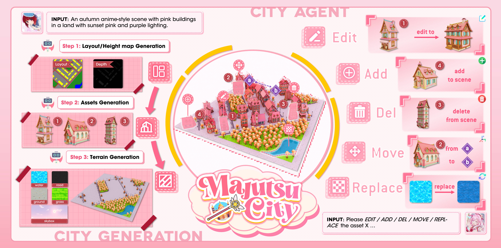
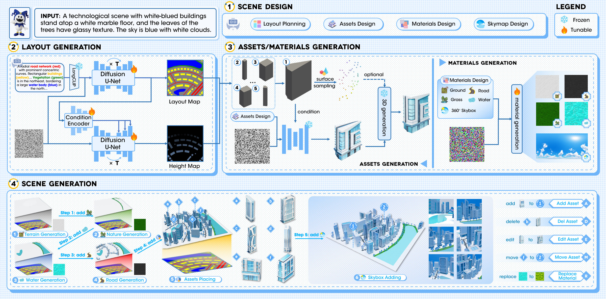

<p align="center">
  
</p>

# MajutsuCity: Language-driven Aesthetic-adaptive City Generation with Controllable 3D Assets and Layouts

<p align="center">
  <a href="https://arxiv.org/abs/2511.20415" target="_blank">
    
  </a>
  <a href="https://github.com/LongHZ140516/MajutsuCity" target="_blank">
    
  </a>
  <a href="https://longhz140516.github.io/MajutsuCity/" target="_blank">
    
  </a>
  <a href="https://huggingface.co/datasets/SereinH/MajutsuDataset" target="_blank">
    
  </a>
  <a href="https://huggingface.co/SereinH/MajutsuCity/tree/main" target="_blank">
    
  </a>
</p>

<p align="center">
  
</p>


## 🏗️ Pipeline Overview

<p align="center">
  
</p>

## 📜 TODO List
- [x] Release ${\color{#8D88E2}MajutsuDataset}$
- [x] Release ${\color{#6EB4F9}MajutsuCity}$
  - [x] Layout Generation model
  - [x] Material texture fintuned model
  - [x] Framework code
- [ ] Release ${\color{#FF7FAE}MajutsuAgent}$ code

## 🪄 Usage

### Installation

Requirements: Linux, Python 3.10, CUDA 12.4, and PyTorch 2.6.0.

```bash
git clone https://github.com/LongHZ140516/MajutsuCity.git
cd MajutsuCity

conda env create -f environment.yml
conda activate majutsucity
```

Obtain the official Hunyuan3D-2.1 source checkout, place it at
`external/Hunyuan3D-2.1`, and compile its two custom extensions as described in
[`requirements/README.md`](requirements/README.md).

### Models and local paths

Copy the example configuration and edit it for your machine:

```bash
cp configs/paths.example.yaml configs/paths.local.yaml
```

All relative paths in `configs/paths.local.yaml` are resolved from the
repository root. GPU allocation is configured with `runtime.qwen_gpu_groups`
and `runtime.hunyuan_gpus`.

The pipeline uses local checkpoints for layout and height generation, image
generation and editing, background removal, 3D reconstruction and painting,
and surface/skybox generation. Expand the panel below for their exact paths and
official download pages.

<details>
<summary><strong>Required model files and download links</strong></summary>

```text
models/
├── MajutsuCity/
│   ├── layout/
│   │   ├── layout_generation.ckpt
│   │   └── height_generation.ckpt
│   └── texture/
│       ├── Texture_Lora.safetensors
│       └── SkyBox_Lora.safetensors
├── LongCLIP-L/longclip-L.pt
├── Qwen-Image-Edit-2509/
├── Qwen-Image/
├── RMBG-2.0/
├── Hunyuan3D-2.1/
└── dinov2-giant/
```

| Model | Source |
| --- | --- |
| MajutsuCity layout, height, texture, and skybox checkpoints | [`SereinH/MajutsuCity`](https://huggingface.co/SereinH/MajutsuCity/tree/main) |
| LongCLIP-L | [`BeichenZhang/LongCLIP-L`](https://huggingface.co/BeichenZhang/LongCLIP-L) |
| Qwen Image Edit 2509 | [`Qwen/Qwen-Image-Edit-2509`](https://huggingface.co/Qwen/Qwen-Image-Edit-2509) |
| Qwen Image | [`Qwen/Qwen-Image`](https://huggingface.co/Qwen/Qwen-Image) |
| RMBG-2.0 | [`briaai/RMBG-2.0`](https://huggingface.co/briaai/RMBG-2.0) |
| Hunyuan3D-2.1 | [`tencent/Hunyuan3D-2.1`](https://huggingface.co/tencent/Hunyuan3D-2.1) |
| DINOv2 Giant | [`facebook/dinov2-giant`](https://huggingface.co/facebook/dinov2-giant) |

Model weights are loaded locally and are not downloaded automatically during a
pipeline run.

</details>

### End-to-end generation with Scene Design API

The recommended entry point is `scripts/generate_city.py`. An OpenAI-compatible
Chat Completions endpoint can turn one scene description into coordinated
prompts for the layout, buildings, props, surface materials, and skybox, then
run the complete city-generation pipeline.

```bash
export MAJUTSUCITY_LLM_BASE_URL="https://your-provider.example/v1"
export MAJUTSUCITY_LLM_API_KEY="your-api-key"
export MAJUTSUCITY_PLANNER_MODEL="your-model"

python scripts/generate_city.py \
  --config configs/paths.local.yaml \
  --case-name planned_city \
  --style Cyberpunk \
  --scene-prompt "A compact coastal city with a connected road network"
```

The generated Scene Plan is saved to `output/<case>/scene_plan.json` and can be
reused without another planning request by passing `--scene-plan <path>`.
Visual asset review is optional: set `MAJUTSUCITY_REVIEW_MODEL` and add
`--enable-vlm-review` only when review and retry are required.

<details>
<summary><strong>Run without the Scene Design API</strong></summary>

Use an existing layout/depth pair:

```bash
python scripts/generate_city.py \
  --config configs/paths.local.yaml \
  --case-name stockholm_cyberpunk \
  --style Cyberpunk \
  --layout examples/pair_cases/layout/SE-Stockholm_64.png \
  --depth examples/pair_cases/depth/SE-Stockholm_64.png
```

Or generate the layout and height map from a layout prompt:

```bash
python scripts/generate_city.py \
  --config configs/paths.local.yaml \
  --case-name generated_cyberpunk_city \
  --style Cyberpunk \
  --layout-prompt "A compact coastal city with a connected road network"
```

</details>

The end-to-end pipeline generates building and environment assets, including
ground, road, vegetation, water, and skybox textures, before assembling the
Blender scene. Existing intermediate results are reused; add `--overwrite` to
regenerate them.

### Outputs

```text
output/<case>/
├── inputs/                         # canonical layout and depth
├── scene_plan.json                 # only with Scene Design
├── assets_<style>/                 # buildings and environment assets
├── scenes/<style>/
│   ├── city_scene.blend
│   ├── preview.png
│   └── assembly_report.json
└── pipeline_run.json
```

For lower-level options, run `python scripts/generate_city.py --help` or
`python scripts/run_pipeline.py --help`. Additional references:

- [Environment construction](requirements/README.md)
- [Standalone layout inference](layout_gen/README.md)
- [Third-party notices](licenses/THIRD_PARTY_NOTICES.md)

## 🙏 Acknowledgements

- Some visual design inspirations (e.g., icons and layout ideas) are adapted from [awesome-framework-gallery](https://github.com/LongHZ140516/awesome-framework-gallery), [Arknights](https://ak.hypergryph.com/#index) and [Arknights: Endfield](https://endfield.hypergryph.com/).
- The *Texture/Skybox LoRA* is trained on the basis of [flymyai-lora-trainer](https://github.com/FlyMyAI/flymyai-lora-trainer).

## 📝 Citation

```bib
@article{huang2025majutsucity,
  title={MajutsuCity: Language-driven Aesthetic-adaptive City Generation with Controllable 3D Assets and Layouts},
  author={Huang, Zilong and He, Jun and Huang, Xiaobin and Xiong, Ziyi and Luo, Yang and Ye, Junyan and Li, Weijia and Chen, Yiping and Han, Ting},
  journal={arXiv preprint arXiv:2511.20415},
  year={2025}
}
```
